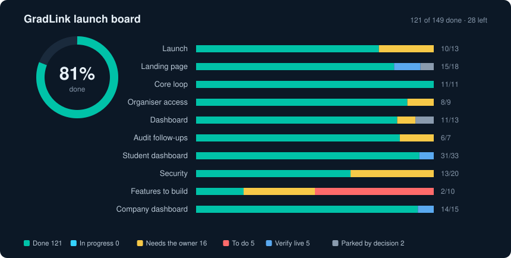
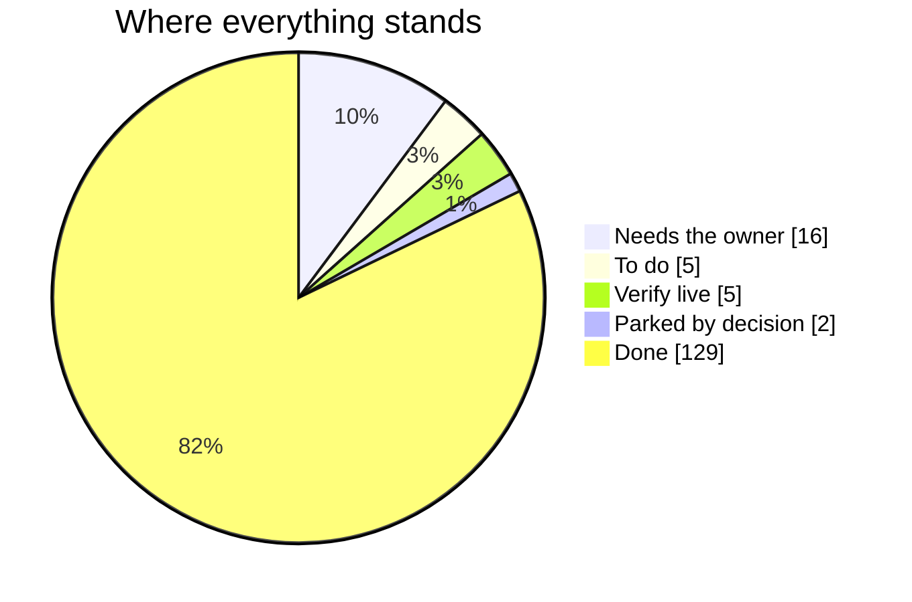
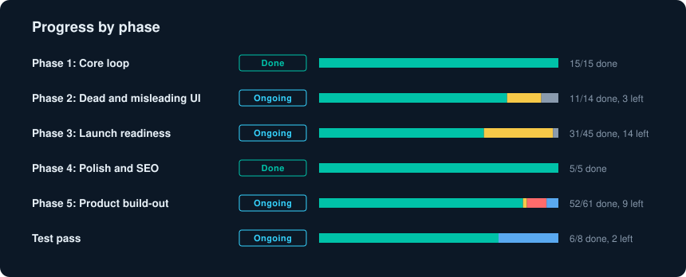

# GradLink Launch Board

> Generated from [`docs/checklists/`](../docs/checklists/) by [`generate.mjs`](generate.mjs). Do not edit this file by hand: tick the item in its checklist and the board rebuilds itself. See [How it updates](#how-it-updates).

**129 of 157 done (82%).** 0 in progress, 28 left. Checklists last changed 2026-10-14.

Open the interactive version: download [`index.html`](index.html) and open it in a browser.

## By phase

| Phase | Status | Progress | Done | In progress | Left |
|---|---|---|---|---|---|
| [Phase 1: Core loop](#phase-1-core-loop) | **Done** | `████████████` 100% | 15 | 0 | 0 |
| [Phase 2: Dead and misleading UI](#phase-2-dead-and-misleading-ui) | **Ongoing** | `██████████░░` 80% | 12 | 0 | 3 |
| [Phase 3: Launch readiness](#phase-3-launch-readiness) | **Ongoing** | `█████████░░░` 72% | 36 | 0 | 14 |
| [Phase 4: Polish and SEO](#phase-4-polish-and-seo) | **Done** | `████████████` 100% | 6 | 0 | 0 |
| [Phase 5: Product build-out](#phase-5-product-build-out) | **Ongoing** | `██████████░░` 86% | 54 | 0 | 9 |
| [Test pass](#test-pass) | **Ongoing** | `█████████░░░` 75% | 6 | 0 | 2 |

### Phase 1: Core loop

Create or join an event, open it, work the checklist, edit the event, with the access checks behind it.

**Done.** 15 of 15 done, 0 in progress, 0 left.

Done (15)

- [x] Users can promote themselves to event manager
- [x] Manager writes are not scoped to their own event
- [x] Any manager can edit any checklist
- [x] No way back to the event list
- [x] New events get no checklist items
- [x] Readiness is always 0%
- [x] Checklist is empty on new events
- [x] No way to edit an event
- [x] Joined events may never appear
- [x] Anyone signed in could read any event's people
- [x] Student analytics never change
- [x] New events had no checklist
- [x] Join code could not be found after creating an event
- [x] Opening a student without an active event caused a server error
- [x] Student profile page scrolled sideways on phones (46px)

### Phase 2: Dead and misleading UI

Every visible button works, nothing claims what the app does not do.

**Ongoing.** 12 of 15 done, 0 in progress, 3 left.

**Left**

- [ ] Several Claude sessions deploy to the same Worker · Needs the owner · Dashboard · [source](https://github.com/divitkej/gradlink/blob/main/docs/checklists/dashboard.md?plain=1#L46)
- [ ] College sidebar has no Messages or Profile link · Needs the owner · Audit follow-ups · [source](https://github.com/divitkej/gradlink/blob/main/docs/checklists/audit-follow-ups.md?plain=1#L26)
- [ ] Pill shapes on labels and tabs · Parked by decision · Dashboard · [source](https://github.com/divitkej/gradlink/blob/main/docs/checklists/dashboard.md?plain=1#L44)

Done (12)

- [x] Navbar logo and section links fail on /pricing
- [x] Colleges and Analytics go to the same section
- [x] Dashboard search box did nothing
- [x] "AI résumé score" claims
- [x] College header said "Live Monitor" with a pulsing dot for events that had not started
- [x] "Everyone is engaged 🎉" with zero students
- [x] "Upgrade to Placement Pro" showed a developer message
- [x] Sidebar links to a section landed at the top of the page
- [x] Em dashes in visible copy
- [x] Unbranded 404 page
- [x] "Start free" does nothing
- [x] Scan history is not linked anywhere

### Phase 3: Launch readiness

Hosting, domain, email, legal pages, honest claims and security before the public launch.

**Ongoing.** 36 of 50 done, 0 in progress, 14 left.

**Left**

- [ ] Cloudflare GitHub builds fail on every commit · Needs the owner · Launch · [source](https://github.com/divitkej/gradlink/blob/main/docs/checklists/launch.md?plain=1#L21)
- [ ] Custom domain · Needs the owner · Launch · [source](https://github.com/divitkej/gradlink/blob/main/docs/checklists/launch.md?plain=1#L26)
- [ ] Account email: confirm email and password reset · Needs the owner · Launch · [source](https://github.com/divitkej/gradlink/blob/main/docs/checklists/launch.md?plain=1#L28)
- [ ] Set `APP_URL` · Needs the owner · Security · [source](https://github.com/divitkej/gradlink/blob/main/docs/checklists/security.md?plain=1#L39)
- [ ] Optional, after the custom domain is connected · Needs the owner · Security · [source](https://github.com/divitkej/gradlink/blob/main/docs/checklists/security.md?plain=1#L41)
- [ ] Least-privilege database role · Needs the owner · Security · [source](https://github.com/divitkej/gradlink/blob/main/docs/checklists/security.md?plain=1#L42)
- [ ] Backups · Needs the owner · Security · [source](https://github.com/divitkej/gradlink/blob/main/docs/checklists/security.md?plain=1#L43)
- [ ] Secrets · Needs the owner · Security · [source](https://github.com/divitkej/gradlink/blob/main/docs/checklists/security.md?plain=1#L44)
- [ ] Account verification · Needs the owner · Security · [source](https://github.com/divitkej/gradlink/blob/main/docs/checklists/security.md?plain=1#L45)
- [ ] Verify live · Needs the owner · Security · [source](https://github.com/divitkej/gradlink/blob/main/docs/checklists/security.md?plain=1#L46)
- [ ] Confirm the claim "Setup in 48 hours" · Needs the owner · Features to build · [source](https://github.com/divitkej/gradlink/blob/main/docs/checklists/features-to-build.md?plain=1#L73)
- [ ] Confirm the claim "No contract lock-in" · Needs the owner · Features to build · [source](https://github.com/divitkej/gradlink/blob/main/docs/checklists/features-to-build.md?plain=1#L74)
- [ ] Confirm the claim "Dedicated onboarding" · Needs the owner · Features to build · [source](https://github.com/divitkej/gradlink/blob/main/docs/checklists/features-to-build.md?plain=1#L75)
- [ ] Promises features that are not built · Parked by decision · Landing page · [source](https://github.com/divitkej/gradlink/blob/main/docs/checklists/landing-page.md?plain=1#L46)

Done (36)

- [x] Neon tables created
- [x] Worker points at the real KV namespace
- [x] Worker secrets set
- [x] Deployed and tested live
- [x] Only Neon and Cloudflare in the repo
- [x] Privacy Policy page
- [x] Terms and Conditions page
- [x] "UAE data residency" claim removed
- [x] Unregistered company name removed
- [x] Favicon
- [x] Social links go nowhere
- [x] 20 footer column links go nowhere
- [x] Invented results in the outcome funnel
- [x] Real brand names used as customers
- [x] Mockups show unlabelled sample data
- [x] Employer CRM mockup buttons do nothing
- [x] Event data was readable by any signed-in account
- [x] A replaced student code kept working on older events
- [x] Private shortlist notes leaked
- [x] Students could set their own résumé score
- [x] Role checks on writes
- [x] Some data API ops skipped the event check or failed on bad input
- [x] Unsafe links in profiles
- [x] Fellow students saw each other's emails
- [x] Achievements, names and files reached more people than the privacy policy says
- [x] Uploads accepted any file type
- [x] No security headers
- [x] Third-party script loaded at runtime
- [x] Checkout trusted request data
- [x] Billing could charge twice or get the plan wrong
- [x] No per-IP limit on the auth endpoints
- [x] Sign-in timing revealed which emails have accounts
- [x] Anyone could claim an unregistered owner address
- [x] Run `npm run db:migrate`
- [x] "GradLink Technologies LLC" in the footer
- [x] "UAE data residency" in the CTA section

### Phase 4: Polish and SEO

Search basics, confirmations, redirects and live updates.

**Done.** 6 of 6 done, 0 in progress, 0 left.

Done (6)

- [x] Add robots.txt and sitemap
- [x] No message after Stripe checkout
- [x] Signed-in people can still open the sign-in page
- [x] Signing in from a scanned QR loses the profile
- [x] New messages need a page reload
- [x] The unread badge could not be cleared from Messages

### Phase 5: Product build-out

Organiser access, the full student dashboard and the features the site promises.

**Ongoing.** 54 of 63 done, 0 in progress, 9 left.

**Left**

- [ ] Set `ADMIN_EMAILS`, then sign up with that email straight away · Needs the owner · Organiser access · [source](https://github.com/divitkej/gradlink/blob/main/docs/checklists/organiser-access.md?plain=1#L30)
- [ ] Build: Offer tracking and placement rate · To do · Features to build · [source](https://github.com/divitkej/gradlink/blob/main/docs/checklists/features-to-build.md?plain=1#L53)
- [ ] Build: Event ROI score · To do · Features to build · [source](https://github.com/divitkej/gradlink/blob/main/docs/checklists/features-to-build.md?plain=1#L54)
- [ ] Build: Candidate stages "Contacted" and "Offer" · To do · Features to build · [source](https://github.com/divitkej/gradlink/blob/main/docs/checklists/features-to-build.md?plain=1#L55)
- [ ] Build: Alumni accounts · To do · Features to build · [source](https://github.com/divitkej/gradlink/blob/main/docs/checklists/features-to-build.md?plain=1#L56)
- [ ] Build: Year-over-year comparison · To do · Features to build · [source](https://github.com/divitkej/gradlink/blob/main/docs/checklists/features-to-build.md?plain=1#L57)
- [ ] Put the branch live · Verify live · Student dashboard · [source](https://github.com/divitkej/gradlink/blob/main/docs/checklists/student-dashboard.md?plain=1#L19)
- [ ] Two-account run on real phones · Verify live · Student dashboard · [source](https://github.com/divitkej/gradlink/blob/main/docs/checklists/student-dashboard.md?plain=1#L94)
- [ ] Put the fixes live · Verify live · Company dashboard · [source](https://github.com/divitkej/gradlink/blob/main/docs/checklists/company-dashboard.md?plain=1#L53)

Done (54)

- [x] Separate codes for students and employers
- [x] Organiser can replace a code
- [x] Students and employers need a code before using the dashboard
- [x] Organiser sees who joined
- [x] Colleges choose a plan after signing in
- [x] Owner dashboard at `/admin`
- [x] Run the migration before deploying this code
- [x] Starter promised one live event but nothing enforced it
- [x] New schema applied to the live Neon database
- [x] Schema applied to the live Neon database
- [x] Tested live on a preview version
- [x] Career Readiness Hub
- [x] Career profile: goal, target roles, projects
- [x] Sessions, booking and waitlists
- [x] Live schedule and event plan
- [x] Digital passport, engagement score, leaderboard
- [x] Matched companies
- [x] Application tracker
- [x] Saved companies in the database
- [x] New events had an empty checklist
- [x] Honest labels and copy
- [x] Automated check
- [x] Interview invites and bookings
- [x] Booth queues
- [x] Notifications
- [x] Opportunities
- [x] Alumni mentoring sessions
- [x] Event history and company connections
- [x] Verified Coursera certificates and courses in progress
- [x] Coursera check from Cloudflare
- [x] Verified LeetCode and Codeforces profiles
- [x] Certificates, replacing test scores
- [x] LeetCode, Codeforces and Credly from Cloudflare
- [x] Scores and engagement are student and college only
- [x] Shortlist decisions stay with their owner
- [x] Company candidate tools
- [x] Courses and scores follow the profile's visibility
- [x] Session times across time zones
- [x] Event dates shifted a day west of London
- [x] Pre-shortlisting from the event console deleted the recruiter's note
- [x] A note typed while the student page was still loading could be wiped
- [x] "Live" badge showed for events that had not started (C3)
- [x] Export button did nothing (C1)
- [x] Filter chips were plain labels (C2)
- [x] "Checked in" showed on every student a company opened
- [x] Real brand names as profile placeholders
- [x] "1 roles posted"
- [x] Student interest never reached the company (Q5)
- [x] New messages needed a reload (G3)
- [x] A failed send stayed on screen as if delivered (G4)
- [x] Student saves lived only in the browser (Q5, first half)
- [x] The company page reset itself and over-counted booth visits
- [x] Companies could see every registered student's email before scanning them
- [x] Opening a student's page counted as a scan

### Test pass

Features that should work, checked once on a real device or the live site.

**Ongoing.** 6 of 8 done, 0 in progress, 2 left.

**Left**

- [ ] Opening hero on a low-end phone · Verify live · Landing page · [source](https://github.com/divitkej/gradlink/blob/main/docs/checklists/landing-page.md?plain=1#L58)
- [ ] Link preview card · Verify live · Landing page · [source](https://github.com/divitkej/gradlink/blob/main/docs/checklists/landing-page.md?plain=1#L60)

Done (6)

- [x] Smooth scroll lands anchor links correctly
- [x] Scroll progress bar and thread
- [x] Navbar links on the home page
- [x] Mobile menu at 375px
- [x] Hero and CTA buttons
- [x] Employer CRM mockup promised scores to employers

## By area

| Area | Progress | Done | Left | Checklist |
|---|---|---|---|---|
| Launch | `█████████░░░` 77% | 10 | 3 | [launch.md](../docs/checklists/launch.md) |
| Landing page | `██████████░░` 83% | 15 | 3 | [landing-page.md](../docs/checklists/landing-page.md) |
| Core loop | `████████████` 100% | 11 | 0 | [core-loop.md](../docs/checklists/core-loop.md) |
| Organiser access | `███████████░` 89% | 8 | 1 | [organiser-access.md](../docs/checklists/organiser-access.md) |
| Dashboard | `██████████░░` 86% | 12 | 2 | [dashboard.md](../docs/checklists/dashboard.md) |
| Audit follow-ups | `███████████░` 88% | 7 | 1 | [audit-follow-ups.md](../docs/checklists/audit-follow-ups.md) |
| Student dashboard | `███████████░` 94% | 31 | 2 | [student-dashboard.md](../docs/checklists/student-dashboard.md) |
| Security | `█████████░░░` 72% | 18 | 7 | [security.md](../docs/checklists/security.md) |
| Features to build | `██░░░░░░░░░░` 20% | 2 | 8 | [features-to-build.md](../docs/checklists/features-to-build.md) |
| Company dashboard | `███████████░` 94% | 15 | 1 | [company-dashboard.md](../docs/checklists/company-dashboard.md) |
| **All** | `██████████░░` **82%** | **129** | **28** | |

## In progress

Nothing is in progress right now. Open a pull request that ticks an item, or put `board: <id>` in its description, and it shows here.

## Left to do

### Needs the owner (16)

- [ ] **Cloudflare GitHub builds fail on every commit** · Launch · [source](https://github.com/divitkej/gradlink/blob/main/docs/checklists/launch.md?plain=1#L21) The Worker is connected to this repo in Cloudflare (Workers Builds) and every build since PR #5 opened has failed; the live site is unaffected because it was deployed with `npm… · id `launch/cloudflare-github-builds-fail-on-every`
- [ ] **Custom domain** · Launch · [source](https://github.com/divitkej/gradlink/blob/main/docs/checklists/launch.md?plain=1#L26) Add the domain to Cloudflare, then attach it to the `gradlink` Worker, set `APP_URL` in `wrangler.jsonc` and change the `SITE_URL` fallback in `lib/site.ts` to it. Owner action,… · id `launch/custom-domain`
- [ ] **Account email: confirm email and password reset** · Launch · [source](https://github.com/divitkej/gradlink/blob/main/docs/checklists/launch.md?plain=1#L28) Built and tested (`lib/server/smtp.ts`, `lib/server/mail.ts`, `/verify-email`): sign-up emails a confirm link and sign-in waits for it, and "Forgot password" emails a reset link.… · id `launch/account-email-confirm-email-and-password`
- [ ] **Set `ADMIN_EMAILS`, then sign up with that email straight away** · Organiser access · [source](https://github.com/divitkej/gradlink/blob/main/docs/checklists/organiser-access.md?plain=1#L30) `npx wrangler secret put ADMIN_EMAILS` with your email. Sign-up now only accepts campus and company domains, and emails in `ADMIN_EMAILS` skip that rule, so a personal address… · id `organiser-access/set-admin-emails-then-sign-up`
- [ ] **Several Claude sessions deploy to the same Worker** · Dashboard · [source](https://github.com/divitkej/gradlink/blob/main/docs/checklists/dashboard.md?plain=1#L46) Each `npm run deploy` replaces the whole live site with that session's branch, so work from other branches disappears from the live site until merged. Deploy only from `main`… · id `dashboard/several-claude-sessions-deploy-to-the`
- [ ] **College sidebar has no Messages or Profile link** · Audit follow-ups · [source](https://github.com/divitkej/gradlink/blob/main/docs/checklists/audit-follow-ups.md?plain=1#L26) Messages is now in the college sidebar ("Add Messages and Scan History to the dashboard sidebar"). Profile is left out by owner decision pending: `/dashboard/profile` has nothing… · id `audit-follow-ups/college-sidebar-has-no-messages-or`
- [ ] **Set `APP_URL`** · Security · [source](https://github.com/divitkej/gradlink/blob/main/docs/checklists/security.md?plain=1#L39) in `wrangler.jsonc` to the custom domain. Reset emails, upload links and Stripe return URLs use it. · id `security/set-app-url`
- [ ] **Optional, after the custom domain is connected** · Security · [source](https://github.com/divitkej/gradlink/blob/main/docs/checklists/security.md?plain=1#L41) add a Cloudflare WAF rate limiting rule on `/api/auth/*` as a second layer. WAF rules attach to your own domain, so they cannot cover the workers.dev address. · id `security/optional-after-the-custom-domain-is`
- [ ] **Least-privilege database role** · Security · [source](https://github.com/divitkej/gradlink/blob/main/docs/checklists/security.md?plain=1#L42) In Neon, create a role with only select, insert, update, delete on the app tables and use it for `DATABASE_URL`, instead of the owner role. Keep the owner role for `npm run… · id `security/least-privilege-database-role`
- [ ] **Backups** · Security · [source](https://github.com/divitkej/gradlink/blob/main/docs/checklists/security.md?plain=1#L43) Confirm Neon's restore window covers at least 7 days. Checked on 2026-10-12: it does not. The Gradlink project keeps 6 hours of history (`history_retention_seconds` 21600). Raise… · id `security/backups`
- [ ] **Secrets** · Security · [source](https://github.com/divitkej/gradlink/blob/main/docs/checklists/security.md?plain=1#L44) Confirm `AUTH_SECRET` is 32+ random characters and differs between local and production. Use Stripe live keys only in production. · id `security/secrets`
- [ ] **Account verification** · Security · [source](https://github.com/divitkej/gradlink/blob/main/docs/checklists/security.md?plain=1#L45) Sign-up now refuses personal, throwaway and test addresses for every role; a college gives an example of its students' email at sign-up, and students can only sign up on that… · id `security/account-verification`
- [ ] **Verify live** · Security · [source](https://github.com/divitkej/gradlink/blob/main/docs/checklists/security.md?plain=1#L46) after deploy, check the headers with https://securityheaders.com and test the QR scanner camera on a phone. · id `security/verify-live`
- [ ] **Confirm the claim "Setup in 48 hours"** · Features to build · [source](https://github.com/divitkej/gradlink/blob/main/docs/checklists/features-to-build.md?plain=1#L73) Where: CTA section · id `features-to-build/setup-in-48-hours`
- [ ] **Confirm the claim "No contract lock-in"** · Features to build · [source](https://github.com/divitkej/gradlink/blob/main/docs/checklists/features-to-build.md?plain=1#L74) Where: CTA section · id `features-to-build/no-contract-lock-in`
- [ ] **Confirm the claim "Dedicated onboarding"** · Features to build · [source](https://github.com/divitkej/gradlink/blob/main/docs/checklists/features-to-build.md?plain=1#L75) Where: CTA section · id `features-to-build/dedicated-onboarding`

### To do (5)

- [ ] **Build: Offer tracking and placement rate** · Features to build · [source](https://github.com/divitkej/gradlink/blob/main/docs/checklists/features-to-build.md?plain=1#L53) Where the site shows it: Analytics funnel, stats panels, Hero dashboard, Product reveal, Journey step 04. Notes: Students log offers in the application tracker (private to them).… · id `features-to-build/offer-tracking-and-placement-rate`
- [ ] **Build: Event ROI score** · Features to build · [source](https://github.com/divitkej/gradlink/blob/main/docs/checklists/features-to-build.md?plain=1#L54) Where the site shows it: Analytics stats. Notes: No formula or data · id `features-to-build/event-roi-score`
- [ ] **Build: Candidate stages "Contacted" and "Offer"** · Features to build · [source](https://github.com/divitkej/gradlink/blob/main/docs/checklists/features-to-build.md?plain=1#L55) Where the site shows it: Employer CRM pipeline, Platform tab CRM mini. Notes: "Interview" now shows from invites; "Contacted" and "Offer" are not tracked for companies · id `features-to-build/candidate-stages-contacted-and-offer`
- [ ] **Build: Alumni accounts** · Features to build · [source](https://github.com/divitkej/gradlink/blob/main/docs/checklists/features-to-build.md?plain=1#L56) Where the site shows it: Why GradLink card "Useful all year round". Notes: Mentoring runs as college-published sessions and internships show on Opportunities; alumni cannot sign… · id `features-to-build/alumni-accounts`
- [ ] **Build: Year-over-year comparison** · Features to build · [source](https://github.com/divitkej/gradlink/blob/main/docs/checklists/features-to-build.md?plain=1#L57) Where the site shows it: Pricing (Placement Pro) · id `features-to-build/year-over-year-comparison`

### Verify live (5)

- [ ] **Opening hero on a low-end phone** · Landing page · [source](https://github.com/divitkej/gradlink/blob/main/docs/checklists/landing-page.md?plain=1#L58) WebGL shader background plus canvas particle text. Now pauses when scrolled past or the tab is hidden, and renders at 1x on phones (4x fewer pixels). The test machine has no GPU… · id `landing-page/opening-hero-on-a-low-end-phone`
- [ ] **Link preview card** · Landing page · [source](https://github.com/divitkej/gradlink/blob/main/docs/checklists/landing-page.md?plain=1#L60) Share image regenerated with the graduation-cap logo (`app/opengraph-image.png`, source `docs/brand/opengraph-image.tsx`, in "Replace the G logo with a graduation cap");… · id `landing-page/link-preview-card`
- [ ] **Put the branch live** · Student dashboard · [source](https://github.com/divitkej/gradlink/blob/main/docs/checklists/student-dashboard.md?plain=1#L19) Merge the PR into main, then `NEXT_PUBLIC_SITE_URL=https://gradlink.divitkej.workers.dev npm run deploy` (or promote the tested preview version `0ec7412c` with `wrangler versions… · id `student-dashboard/put-the-branch-live`
- [ ] **Two-account run on real phones** · Student dashboard · [source](https://github.com/divitkej/gradlink/blob/main/docs/checklists/student-dashboard.md?plain=1#L94) Student books a full session, organiser marks attendance, student sees the passport stop and score change. Verify live · id `student-dashboard/two-account-run-on-real-phones`
- [ ] **Put the fixes live** · Company dashboard · [source](https://github.com/divitkej/gradlink/blob/main/docs/checklists/company-dashboard.md?plain=1#L53) Merge the PR into main, then deploy from main. Verify live · id `company-dashboard/put-the-fixes-live`

### Parked by decision (2)

- [ ] **Promises features that are not built** · Landing page · [source](https://github.com/divitkej/gradlink/blob/main/docs/checklists/landing-page.md?plain=1#L46) Kept on the page by decision. Every unbuilt feature, and where it appears, is listed in `docs/checklists/features-to-build.md`. `components/landing/*` · Tracked · id `landing-page/promises-features-that-are-not-built`
- [ ] **Pill shapes on labels and tabs** · Dashboard · [source](https://github.com/divitkej/gradlink/blob/main/docs/checklists/dashboard.md?plain=1#L44) Section badges on the landing page, role chips, the manual tabs and "Back to site" are fully rounded. Left as they are by decision for now. Tracked · id `dashboard/pill-shapes-on-labels-and-tabs`

## Done

<b>Launch</b>: 10 done

- [x] Neon tables created
- [x] Worker points at the real KV namespace Done in "Point the UPLOADS binding at the real KV namespace"
- [x] Worker secrets set
- [x] Deployed and tested live
- [x] Only Neon and Cloudflare in the repo Done in "Remove Vercel, Supabase and Firebase leftovers"
- [x] Privacy Policy page Done in "Add Privacy Policy and Terms pages"
- [x] Terms and Conditions page Done in "Add Privacy Policy and Terms pages"
- [x] "UAE data residency" claim removed Done in "Add Privacy Policy and Terms pages"
- [x] Unregistered company name removed Done in "Drop the unregistered company name from the footer"
- [x] Favicon Done in "Replace the G logo with a graduation cap"

<b>Landing page</b>: 15 done

- [x] Navbar logo and section links fail on /pricing Done in "Fix landing links, sample-data labels and SEO basics"
- [x] Colleges and Analytics go to the same section Done in "Fix landing links, sample-data labels and SEO basics"
- [x] Social links go nowhere Done in "Fix landing links, sample-data labels and SEO basics"
- [x] 20 footer column links go nowhere Done in "Fix landing links, sample-data labels and SEO basics"
- [x] Invented results in the outcome funnel Done in "Fix landing links, sample-data labels and SEO basics"
- [x] Real brand names used as customers Done in "Fix landing links, sample-data labels and SEO basics"
- [x] Mockups show unlabelled sample data Done in "Fix landing links, sample-data labels and SEO basics"
- [x] Employer CRM mockup buttons do nothing Done in "Stop the Employer CRM mockup looking clickable"
- [x] Add robots.txt and sitemap Done in "Fix landing links, sample-data labels and SEO basics"
- [x] Smooth scroll lands anchor links correctly Done in "Fix landing links, sample-data labels and SEO basics"
- [x] Scroll progress bar and thread
- [x] Navbar links on the home page Done in "Fix landing links, sample-data labels and SEO basics"
- [x] Mobile menu at 375px Done in "Fix landing links, sample-data labels and SEO basics"
- [x] Hero and CTA buttons Done in "Fix landing links, sample-data labels and SEO basics"
- [x] Employer CRM mockup promised scores to employers Done in "Keep student assessments away from employers"

<b>Core loop</b>: 11 done

- [x] Users can promote themselves to event manager Done in "Fix Phase 1 core loop: event nav, checklist seeding, event editing"
- [x] Manager writes are not scoped to their own event Done in "Fix Phase 1 core loop: event nav, checklist seeding, event editing"
- [x] Any manager can edit any checklist Done in "Fix Phase 1 core loop: event nav, checklist seeding, event editing"
- [x] No way back to the event list Done in "Fix Phase 1 core loop: event nav, checklist seeding, event editing"
- [x] New events get no checklist items Done in "Fix Phase 1 core loop: event nav, checklist seeding, event editing"
- [x] Readiness is always 0% Done in "Fix Phase 1 core loop: event nav, checklist seeding, event editing"
- [x] Checklist is empty on new events Done in "Fix Phase 1 core loop: event nav, checklist seeding, event editing"
- [x] No way to edit an event Done in "Fix Phase 1 core loop: event nav, checklist seeding, event editing"
- [x] Joined events may never appear Done in "Fix Phase 1 core loop: event nav, checklist seeding, event editing"
- [x] Anyone signed in could read any event's people Done in "Scope event data to members and compute analytics live"
- [x] Student analytics never change Done in "Scope event data to members and compute analytics live"

<b>Organiser access</b>: 8 done

- [x] Separate codes for students and employers Done in "Add separate student and employer codes, plan choice and owner dashboard"
- [x] Organiser can replace a code Done in "Add separate student and employer codes, plan choice and owner dashboard"
- [x] Students and employers need a code before using the dashboard Done in "Add separate student and employer codes, plan choice and owner dashboard"
- [x] Organiser sees who joined Done in "Add separate student and employer codes, plan choice and owner dashboard"
- [x] Colleges choose a plan after signing in Done in "Add separate student and employer codes, plan choice and owner dashboard"
- [x] Owner dashboard at `/admin` Done in "Add separate student and employer codes, plan choice and owner dashboard"
- [x] Run the migration before deploying this code
- [x] Starter promised one live event but nothing enforced it Done in "Say Starter includes unlimited events"

<b>Dashboard</b>: 12 done

- [x] New events had no checklist Done in "Fix the problems found in the site audit"
- [x] Join code could not be found after creating an event Done in "Fix the problems found in the site audit"
- [x] Opening a student without an active event caused a server error Done in "Fix the problems found in the site audit"
- [x] Student profile page scrolled sideways on phones (46px) Done in "Fix the problems found in the site audit"
- [x] Dashboard search box did nothing Done in "Fix the problems found in the site audit"
- [x] "AI résumé score" claims Done in "Fix the problems found in the site audit"
- [x] College header said "Live Monitor" with a pulsing dot for events that had not started Done in "Fix the problems found in the site audit"
- [x] "Everyone is engaged 🎉" with zero students Done in "Fix the problems found in the site audit"
- [x] "Upgrade to Placement Pro" showed a developer message Done in "Fix the problems found in the site audit"
- [x] Sidebar links to a section landed at the top of the page Done in "Scroll sidebar section links to their section once it has loaded"
- [x] Em dashes in visible copy Done in "Fix the problems found in the site audit"
- [x] Unbranded 404 page Done in "Fix the problems found in the site audit"

<b>Audit follow-ups</b>: 7 done

- [x] "Start free" does nothing Done in "Send the pricing Start free button to sign-up"
- [x] No message after Stripe checkout Done in "Confirm Stripe checkout results on the dashboard and pricing page"
- [x] Scan history is not linked anywhere Done in "Add Messages and Scan History to the dashboard sidebar"
- [x] Signed-in people can still open the sign-in page Done in "Send signed-in people from the sign-in page to their dashboard"
- [x] Signing in from a scanned QR loses the profile Done in "Return to the scanned profile after signing in from a QR"
- [x] New messages need a page reload Done in "Show new messages in an open conversation without a reload"
- [x] The unread badge could not be cleared from Messages Done in "Show unread messages at other events in the inbox"

<b>Student dashboard</b>: 31 done

- [x] New schema applied to the live Neon database
- [x] Schema applied to the live Neon database
- [x] Tested live on a preview version
- [x] Career Readiness Hub Done in "Complete the student dashboard against the landing page"
- [x] Career profile: goal, target roles, projects Done in "Complete the student dashboard against the landing page"
- [x] Sessions, booking and waitlists Done in "Complete the student dashboard against the landing page"
- [x] Live schedule and event plan Done in "Complete the student dashboard against the landing page"
- [x] Digital passport, engagement score, leaderboard Done in "Complete the student dashboard against the landing page"
- [x] Matched companies Done in "Complete the student dashboard against the landing page"
- [x] Application tracker Done in "Complete the student dashboard against the landing page"
- [x] Saved companies in the database Done in "Complete the student dashboard against the landing page"
- [x] New events had an empty checklist Done in "Complete the student dashboard against the landing page"
- [x] Honest labels and copy Done in "Complete the student dashboard against the landing page"
- [x] Automated check Done in "Complete the student dashboard against the landing page"
- [x] Interview invites and bookings Done in "Finish the student side: invites, queues, alerts, opportunities"
- [x] Booth queues Done in "Finish the student side: invites, queues, alerts, opportunities"
- [x] Notifications Done in "Finish the student side: invites, queues, alerts, opportunities"
- [x] Opportunities Done in "Finish the student side: invites, queues, alerts, opportunities"
- [x] Alumni mentoring sessions Done in "Finish the student side: invites, queues, alerts, opportunities"
- [x] Event history and company connections Done in "Finish the student side: invites, queues, alerts, opportunities"
- [x] Verified Coursera certificates and courses in progress Done in "Verify Coursera certificates on the student profile"
- [x] Coursera check from Cloudflare Done in "Tell a Coursera outage apart from a missing course"
- [x] Verified LeetCode and Codeforces profiles Done in "Add event time zones, coding profiles and test scores"
- [x] Certificates, replacing test scores Done in "Replace test scores with verified certificates"
- [x] LeetCode, Codeforces and Credly from Cloudflare
- [x] Scores and engagement are student and college only Done in "Keep student assessments away from employers"
- [x] Shortlist decisions stay with their owner Done in "Keep student assessments away from employers"
- [x] Company candidate tools Done in "Keep student assessments away from employers"
- [x] Courses and scores follow the profile's visibility Done in "Show courses and scores only to people who share an event"
- [x] Session times across time zones Done in "Add event time zones, coding profiles and test scores"
- [x] Event dates shifted a day west of London Done in "Add event time zones, coding profiles and test scores"

<b>Security</b>: 18 done

- [x] Event data was readable by any signed-in account Done in "Lock down the data API, uploads and response headers"
- [x] A replaced student code kept working on older events Done in "Make a replaced join code stop working on older events"
- [x] Private shortlist notes leaked Done in "Lock down the data API, uploads and response headers"
- [x] Students could set their own résumé score Done in "Lock down the data API, uploads and response headers"
- [x] Role checks on writes Done in "Lock down the data API, uploads and response headers"
- [x] Some data API ops skipped the event check or failed on bad input Done in "Check event membership and input in more data API ops"
- [x] Unsafe links in profiles Done in "Lock down the data API, uploads and response headers"
- [x] Fellow students saw each other's emails Done in "Lock down the data API, uploads and response headers"
- [x] Achievements, names and files reached more people than the privacy policy says Done in "Limit achievements, names and files to the people the privacy policy names"
- [x] Uploads accepted any file type Done in "Lock down the data API, uploads and response headers"
- [x] No security headers Done in "Lock down the data API, uploads and response headers"
- [x] Third-party script loaded at runtime Done in "Lock down the data API, uploads and response headers"
- [x] Checkout trusted request data Done in "Lock down the data API, uploads and response headers"
- [x] Billing could charge twice or get the plan wrong Done in "Stop double charges and wrong plans in checkout and the Stripe webhook"
- [x] No per-IP limit on the auth endpoints Done in "Rate-limit sign-in, sign-up and password reset per IP"
- [x] Sign-in timing revealed which emails have accounts Done in "Lock down the data API, uploads and response headers"
- [x] Anyone could claim an unregistered owner address Done in "Stop unregistered owner addresses being claimed while email is off"
- [x] Run `npm run db:migrate`

<b>Features to build</b>: 2 done

- [x] "GradLink Technologies LLC" in the footer Done in "Drop the unregistered company name from the footer"
- [x] "UAE data residency" in the CTA section Done in "Add Privacy Policy and Terms pages"

<b>Company dashboard</b>: 15 done

- [x] Pre-shortlisting from the event console deleted the recruiter's note Done in "Fix the company-side problems found in the live test"
- [x] A note typed while the student page was still loading could be wiped Done in "Fix the company-side problems found in the live test"
- [x] "Live" badge showed for events that had not started (C3)
- [x] Export button did nothing (C1)
- [x] Filter chips were plain labels (C2)
- [x] "Checked in" showed on every student a company opened
- [x] Real brand names as profile placeholders Done in "Fix the company-side problems found in the live test"
- [x] "1 roles posted" Done in "Fix the company-side problems found in the live test"
- [x] Student interest never reached the company (Q5) Done in "Fix the company-side problems found in the live test"
- [x] New messages needed a reload (G3) Done in "Fix the company-side problems found in the live test"
- [x] A failed send stayed on screen as if delivered (G4) Done in "Fix the company-side problems found in the live test"
- [x] Student saves lived only in the browser (Q5, first half)
- [x] The company page reset itself and over-counted booth visits Done in "Stop the company page resetting and count booth visitors once"
- [x] Companies could see every registered student's email before scanning them Done in "Show companies a student's email only after scanning them"
- [x] Opening a student's page counted as a scan Done in "Count a scan only when the QR's scan key comes with it"

## How it updates

- **Source of truth:** every item lives in a file in [`docs/checklists/`](../docs/checklists/). Change the checkbox there, never here.
- **Done:** tick the box (`- [x]`) in the same commit as the fix. When that commit reaches `main`, the [Launch board workflow](../.github/workflows/launch-board.yml) rebuilds this folder and commits it.
- **In progress:** open a pull request that ticks the box. The item shows as in progress, with a link to the PR, until the PR merges. You can also write `board: <id>` in a PR's title or description (ids are listed under each item).
- **Phases:** an item's phase comes from a `· Phase N` tag on its status line, then a `## Phase N: ...` section heading, then the checklist it lives in. A phase is Done when every item is done, Ongoing once anything in it is done or in progress, and Not started otherwise.
- **Needs the owner, Verify live, Parked:** read from the item's own words ("Owner action", "Verify live", "Tracked") or its section heading.
- **New items or checklists:** add a `- [ ] **Title.** details` line to any checklist, or a new `docs/checklists/<area>.md` file. The board picks it up on the next run.
- **Run it yourself:** `node launch-board/generate.mjs`. Set `GITHUB_TOKEN` to include open pull requests.
